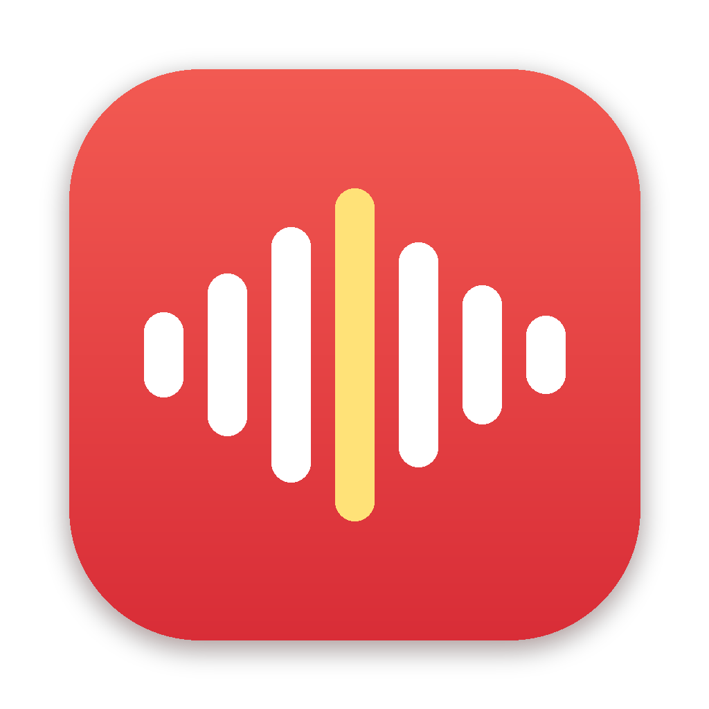

<p align="center"></p>

# Bolo

**Hold fn, speak, let go, and Bolo types what you said wherever your cursor is:** WhatsApp, Gmail, Notes, Slack, anything. It understands **English, Hindi and Hinglish**, and runs **fully offline** on your Mac. Nothing you say leaves your computer.

### [⬇️ Download Bolo (free)](https://github.com/rajmans123-netizen/bolo/releases/latest/download/Bolo.zip)

| You say | Bolo types |
|---|---|
| "umm so I'm running late, I'll reach by eleven" | I am running late. I'll reach by 11. |
| "Bhai aaj shaam ko cricket chalein?" | Bhai aaj shaam ko cricket chalein? (or हिन्दी, your choice) |
| "Yaar the presentation is almost done, bas two slides baaki hain" | Yaar, the presentation is almost done, bas two slides baaki hain |

## Install
1. Download **Bolo.zip**, unzip it, and drag **Bolo** into **Applications**.
2. Open it. Bolo isn't signed with a paid Apple developer ID, so the first time go to **System Settings → Privacy & Security → Open Anyway**.
3. Allow **Microphone**, then turn Bolo on in **System Settings → Privacy & Security → Accessibility**, so it can type into other apps.
4. **System Settings → Keyboard → "Press 🌐 key to" → Do Nothing**, so fn doesn't open the emoji picker.
5. Hold **fn**, talk, let go. The menu bar icon has Language (Auto / English / Hindi), Hinglish or हिन्दी output, and the key (fn or right ⌥).

Needs **macOS 26 or newer**. Clean-up uses Apple Intelligence where it's available (Apple silicon); without it, Bolo still types.

## Build it yourself
```sh
./build.sh   # needs the Xcode Command Line Tools (swiftc); output: build/Bolo.app
```

## Credits
Inspired by **Wispr Flow**. Bolo is an independent rebuild written from scratch with [Claude](https://claude.ai) for [Raj Tries](https://www.instagram.com/raj_triess/), build 9 of 30. It uses Apple's on-device speech recognition. MIT licence.
